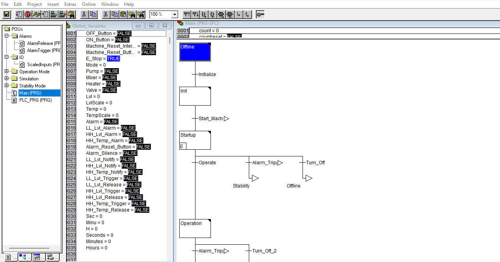

# **Multi-Language PLC Project**

#### **Link to Demo Video**
[Bryan_Chung_PLC_Portfolio](https://sites.google.com/view/bryan-chung/home)

#### **Project Description**
This project simulates controlling the level and temperature of a tank with 4 devices (pump, valve, heater, mixer), a 5-state system, three alarms. E-stop, and interlock. The project was made in Automation Builder 2.9. The purpose of this project was to showcase my ability to program in multiple IEC lanagues. The state system was made in SFC with each stage coded with a different programming language including LD, FBD, ST, CFC, and IL.

Low level alarm triggers when tank level below 20%. High level alarm triggers when tank level above 80%. High temp alarm triggers when temp is above 500. There is a 5 second delay to turn on and off devices and level and temp values are updated every 5 seconds.

#### **Safety Measures**
System includes three alarms, E-Stop, and safety interlock. The alarms each have a notify bit to alert the operator. The operator can use the silence button to acknowledge alarms. Alarm reset button will not reset alarms and return to operation mode until fault condition is also cleared. Off button will return system to offline mode. E-Stop will do the same while also triggering an interlock that will prevent the machine from turning on again without resetting the interlock with the machine reset button.

#### **How to Install Project**
1. Download Automation Builder 2.9 here,  earlier versions will not run the program: [Automation Builder Download](https://www.abb.com/global/en/areas/motion/digital-tools/automation-builder/software-download)
2. Extract archive file
3. Open archive file to open file in Automation Builder
4. Click extract when the window pops up

#### **How to Run Project**
1. Double Click Applicaiton
2. Open the Main program to visualize the process entering different states during simulation
3. Open Global Variable page in resources tab and split screen with Main program
4. Open the Online drop down menu and login
5. Click Run
6. Double click On button in global variable page and then press Ctrl+F7 to write value. Simulation should start and enter startup mode.
7. Level and Temperature values can be rewritten with a range between 0-16383 with variables Lvl and Temp to trigger alarms and stability mode.
Monitor physical values with LvlScale and TempScale
8. Turning on alarm silence turns off notifications, turning on alarm reset button transitions to operation mode when condition that triggered respective alarm is also cleared
9. Off button returns machine to offline mode. E-Stop button does the same but also triggers interlock that must be cleared with machine reset button before On button can turn machine on again.
