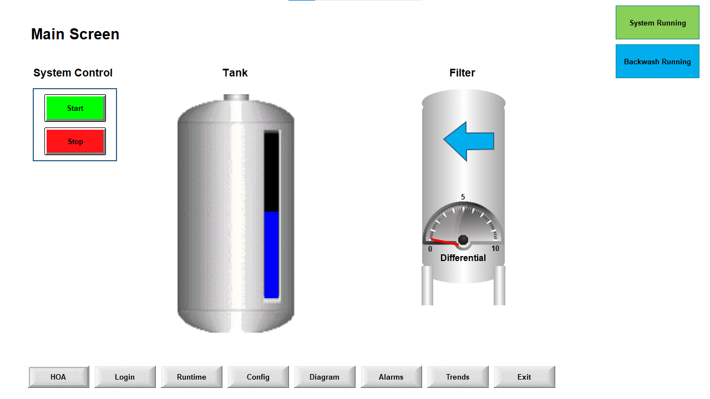
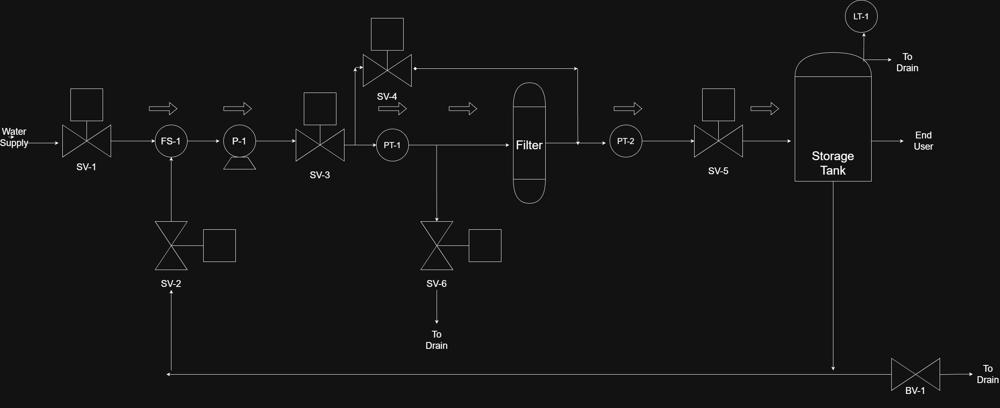
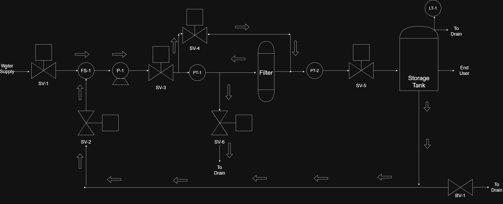

# **Wonderware HMI Project**

This project simulates a water filtration system with backwash capabilities. The goal of the project is to design a human-machine interface (HMI) that communicates with instructor given PLC code when simulated while providing a user friendly experience for the operator.



#### **Link to Demo Video**
[Bryan_Chung_PLC_Portfolio](https://sites.google.com/view/bryan-chung/home)

The demo video is the second video in the portfolio.

#### **Project Description**
 **The HMI made in Wonderware was my own work with the  code made in RSLogix Micro Starter Lite was instructor given.** Legacy design philosophy was intentionally used for the HMI with bright colors for buttons and visualization of devices to demonstrate capability to use Wonderware's features. 



Normal flow as depicted in the process flow diagram above will initiate when start button is pressed. All solenoid valves and the pump have HOA controls that can be accessed on the HOA screen. There are alarms for levels being too low or high in the tank, if water flow is too low or if the pressure in the filter is too high. Setpoints triggering alarms can be altered in the config screen with proper login access.



Backwash Flow will activate when differential pressure in the filter is greater than 5 PSI or backwash is pended, reversing flow and cleaning excess contaminants from the filter. Backwash path is shown above.

Config Screen and Runtime Screens cannot be interacted without proper access by logging in with the right user in the Login Screen. Operators can use config screen and username and password are both 'A'. Managers can use runtime screen and username and password are 'B'. OEM has access to both and username and password are both 'C'. All usernames and passwords are not case sensitive.


#### **File Directory**
```
|   HMI_Project_Data_Mapping Table.md
|   HMI_Project_PLC.zip
|   HMI_Project_Wonderware.zip
|   README.txt
|
\---screenshots
        Backwash_Flow_PFD.drawio.png
        HMI_Main_Screen_Screenshot.png
        Normal_Flow_PFD.drawio.png
```

#### **Memory Map Snippet**
| Tag Name               | Type    | I/O Address | Action     |
| ---------------------- | ------- | ----------- | ---------- |
| Pb_Start               | Boolean | B3:3/3      | Read+Write |
| Alarm_Reset            | Boolean | B3:3/9      | Read+Write |
| Level_LL_Alarm         | Boolean | B3:4/12     | Read+Write 
| Sv_Tank_Level          | Integer | F8:2        | Read+Write |
| SysRunning             | Boolean | B3:3/8      | Read+Write |
| Backwash_Running       | Boolean | B3:4/6      | Read+Write |
| Diff_Pres              | Real    | F8:3        | Read+Write |
| Backwash_Cycle_Pending | Boolean | B3:4/5      | Read+Write |
| SysStop                | Boolean | B3:3/2      | Read+Write |

#### **Communications and Development Environment**
Using the SLC 500 driver in RSLinx, the RSLogix 500 code in Micro Starter Lite and the MicroLogix 1100 plc on RS Emulate, the plc code can be simulated within a pc without actual physical hardware. The HMI was made in Wonderware 8.0 and the simulated HMI is connected to the simulated PLC using com0com.

#### **Future Changes**
Navigation could be more intuitive by keeping buttons in the same place on every screen as adding redundant buttons for the screen the HMI is already on will be more operator friendly. To adhere to ISA-101, a future version would remove all color from the design except for alarm states to emphasize the danger to operators by contrast. Visual representations of devices will be removed if not necessary favoring simple diagrams with greyscale for color. Design would emphasize clarity and ease of use for the operator's tasks.
